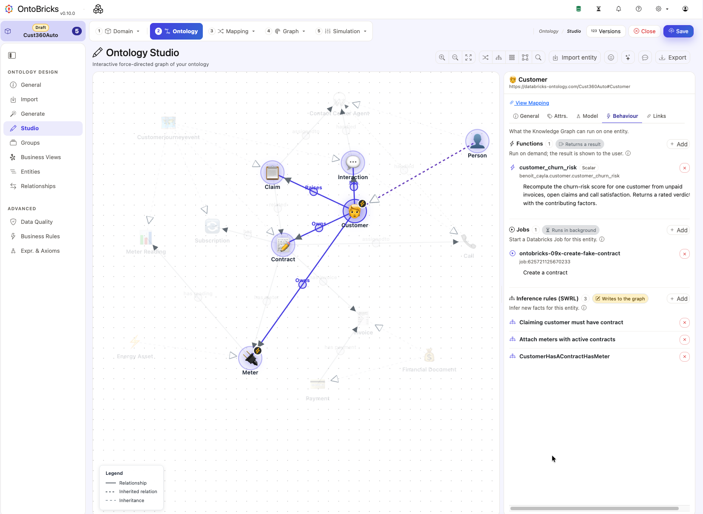

<p align="center">
  
</p>

<h1 align="center">OntoBricks 0.10.0</h1>

<p align="center">
  <strong>Design, build, understand and test your knowledge store — on Databricks.</strong>
</p>

<p align="center">
  <a href="https://ontobricks.org/">Website</a>
  ·
  <a href="https://ontobricks.org/">Demos &amp; Screenshots</a>
  ·
  <a href="https://github.com/databrickslabs/ontobricks">GitHub</a>
  ·
  <a href="docs/README.md">Documentation</a>
</p>

<p align="center">
  
  
  
  
</p>

<table>
<tr>
<td>

### What's new in 0.10.0

- **What-if simulation sandboxes**: build scenarios with hypothetical facts (add, remove, or set), written by hand, through a fact wizard, or with the natural-language agent. Run them in an isolated sandbox, explore the result in Explorer, and compare it with the Original Graph.
- **Simulation API**: create, run and read scenarios over REST (`/api/v1/simulations`), and query a ready sandbox through the graph endpoints.
- **Graph Chat and search in the viewer**: search the graph and ask questions about it from Explorer.
- **Patterns and communities at scale**: community detection and pattern detection handle larger graphs (Coverage KPI, hub pruning).
- **Graph Analytics in Intelligence**: PageRank, betweenness, degree, closeness and clustering on a Databricks job, with Dashboard, Data Model Health, Interpret and run history.
- **JSON-LD everywhere it matters**: OWL import and export, SPARQL `CONSTRUCT`/`DESCRIBE` results, and the MCP `describe_ontology` tool.
- **Pluggable graph backends**: Delta, Lakebase and Neo4j sit behind shared capability interfaces, so each engine exposes what it supports and nothing more.
- **Live Data Quality runs**: bulk checks run on a view-backed snapshot and show a live activity log.
- **Auto-Map for metric views**: Auto-Map emits Unity Catalog metric-view SQL.
- **Typed SPARQL filters**: value `FILTER`s on typed literals compile to SQL.
- **MCP improvements**: end-user identity is forwarded past the Apps proxy, and graph tools work without a sticky session.
- **Safer mapping edits**: unmapping keeps hidden entities and relationships, and set-attribute literals are materialised on entities.
- **Dependency security floors**: raised for several Dependabot advisories (oauthlib, dnspython, opentelemetry-api, authlib and others).

Full details are in the [documentation](docs/README.md#whats-new-in-0100).

</td>
</tr>
</table>

---

Every enterprise has the data. Almost none have the **meaning**. Your Lakehouse
stores billions of rows, but nothing captures what they *represent* — that a
*Customer* holds *Contracts*, which contain *Invoices*, governed by rules only
your senior engineers remember.

**OntoBricks closes that gap.** It is a Databricks-native app that turns Unity
Catalog tables into an explorable, queryable **knowledge graph** — design the
meaning, let AI map it to your data, and navigate the result visually or expose
it to your favorite LLM. No separate graph platform, no RDF expertise, no
months-long integration project.

## Why OntoBricks

- **From schema to graph in minutes, not months.** LLM-powered automation drives
  the whole pipeline — import metadata, generate the ontology, map the data,
  materialize the graph.
- **Lives inside Databricks.** Deploys as a Databricks App and reuses what you
  already have: Unity Catalog, SQL Warehouse, AI Gateway or Model Serving,
  and Lakebase. Your
  triples stay in your Lakehouse.
- **Standards under the hood, simplicity on top.** W3C **OWL**, **JSON-LD**,
  **R2RML**, **SPARQL**, and **SHACL** power the engine; everything executes as
  Spark SQL. Your users never touch RDF. Ontologies import/export as Turtle or
  JSON-LD; SPARQL `CONSTRUCT`/`DESCRIBE` can return JSON-LD for APIs and agents.
- **Built for the AI era.** Publish any domain to LLM agents over the Model
  Context Protocol (MCP) and let them reason over governed, explainable
  business semantics.
- **Governed by design.** Versioned domains, DRAFT → IN-REVIEW → PUBLISHED
  lifecycle, single-editor locking, and an append-only review audit trail.
- **Parse documents once, reuse them everywhere.** Uploaded PDF, Office, image,
  and text sources are parsed into a versioned **Knowledge Store** (parsed text
  in Lakebase; originals are not retained) shared by ontology Generate and
  Mapping; failed parses are visible and retryable.

## From tables to a knowledge graph in four clicks

| Step | Action | What happens | Powered by |
|------|--------|--------------|------------|
| **1** | **Import Metadata** — Context &gt; Data Assets | Fetches table &amp; column metadata from Unity Catalog | Unity Catalog |
| **2** | **Generate Ontology** — Ontology &gt; Wizard | The LLM designs entities, relationships &amp; attributes from your metadata | AI Gateway / Model Serving |
| **3** | **Auto-Map** — Mapping &gt; Auto-Map | The LLM generates SQL mappings for every entity and relationship | AI Gateway / Model Serving |
| **4** | **Synchronize** — Graph &gt; Build | Executes the mappings and populates the triple store | SQL Warehouse |

After **Build**, open **Intelligence** (app switcher → Home) to score the
graph (**Analytics**), find clusters (**Communities**) and look-alikes
(**Patterns**), then run what-if **Scenarios** without touching live data.
The in-app Help **Starter Guide** walks the same path.

Prefer full control? Every step is also available as a guided **manual
workflow** — design, map, build, query, reason, and simulate at column-level precision.
See the [User Guide](docs/user-guide.md) and the
[Intelligence guide](docs/intelligence.md).

### Run a context without an LLM

Selecting **No LLM** is a strict context-level opt-out. LLM actions remain
visible but unavailable and direct API calls are rejected with guidance to
select a model in **Configuration → AI**. Select and save an LLM there to
make those actions available again without reloading the page. Deterministic
reasoning and validation, including OWL/IF-THEN inference and SHACL data-quality
checks, remain available while No LLM is selected.

## What's inside

### Design ontologies visually or with AI
Drag-and-drop entities, relationships and inheritance on the **OntoViz** canvas,
or import industry standards in one click (FIBO, CDISC, IOF, HL7 FHIR
R4/R4B/R5) and your own OWL/RDFS. A floating **AI Assistant** edits your
ontology through natural language.

<p align="center">
  
</p>

**Generate** drives that AI design through a resumable, human-in-the-loop
wizard — **Detect** candidate entities from metadata and your parsed document
corpus, **Review** them (include/exclude, edit labels, add your own), then
**Complete** relations, attributes, and axioms in that order. Every run
**appends** to your existing ontology — locked entities are never renamed or
removed — and a stale draft (source changed since detection) is flagged with
a one-click **Re-detect** instead of silently reusing outdated candidates.

### Map to your data — automatically
Let the LLM generate SQL and column mappings for every entity and relationship,
then refine with live data preview. Mappings compile to W3C-compliant **R2RML**
you never have to write. Schema-drift warnings flag upstream renames and drops
before they break your graph.

### Build, reason and explore
Materialize triples incrementally, then **reason** over the graph with OWL 2 RL
inference, IF-THEN rules and SHACL validation. Explore interactively: two-phase
search, N-hop neighbour expansion, cross-domain bridge navigation, community
detection from Intelligence → Discovery → Communities (label propagation on a Databricks
job, so it scales to graphs of any size), and explainable
**cohort discovery**. Right-click any entity to run its **Data Quality Checks**
(every SHACL shape on its class, its parents and the global ones, with
per-dimension gauges), one of its **IF-THEN business rules**, or a class action
(Unity Catalog function or **Databricks Job**) — the same checks and actions are
MCP tools. Lakehouse domains can optionally read from a **Lakehouse//RT**
query warehouse while builds stay on a classic or serverless warehouse. Query
everything through an auto-generated **GraphQL** API or open **Graph
→ Query → SPARQL** for read-only SELECT queries, sample queries, CSV export,
generated SQL inspection, and triple-shaped results that open in Explorer.
See the [SPARQL Playground guide](docs/user-guide.md#sparql-playground),
[Get Started](docs/getting-started.md), and
[Cohort Discovery](docs/advanced_features.md#cohort-discovery).

### Discover and simulate (Intelligence)
The **Intelligence** workspace turns a built graph into insight.
**Home** lists every page as tiles. **Analytics** scores influence and
bridges (PageRank, betweenness, degree, closeness, clustering).
**Cohorts** group entities with explainable rules, **Communities** finds
tightly connected clusters, and **Patterns** finds entities that look alike
(recurring neighbourhood profiles, Coverage KPI) — Discovery jobs run on Databricks. **Scenarios**
copies an entity neighbourhood or a cohort into a private sandbox, applies
hypothetical facts ("what if this customer switches to the Green tariff?"),
re-runs your IF-THEN, graph and business rules there, and shows exactly which
triples would be added or removed — the live knowledge graph is never
modified. **Compare** then overlays a ready scenario on today's Original Graph and
asks the same business question to both, with an AI commentary and a PDF
report. Start from **Scenarios → New scenario** or **Simulate from here** on
any Explorer entity. Lakebase, Lakehouse (Delta), and Neo4j backends are
supported. Each page has a **How it works** tab with business-friendly
diagrams. See the
[Intelligence guide](docs/intelligence.md).

### Publish to AI agents (MCP)
Expose your knowledge graph to Cursor, Claude Desktop or the Databricks
Playground over the [Model Context Protocol](https://modelcontextprotocol.io/).
Each domain decides exactly **what it publishes** — which tools, which datasets,
which class actions and virtual attributes — right down to ontology-only domains
that expose a single `describe_ontology` tool. See
[MCP Integration](docs/mcp.md).

### Govern the whole lifecycle
Every domain version carries a **DRAFT / IN-REVIEW / PUBLISHED** status enforced
server-side. A **single editor** holds a DRAFT at a time (auto-releasing leases,
admin take-over), a business-friendly **review workflow** collects sign-offs
with a configurable quorum, and every decision is persisted append-only.
Administrators can safely delete only older, unloaded Draft versions; deletion
atomically rechecks Draft status before attempting permanent removal of that
version's Knowledge Store content. Cleanup failures are reported as errors
rather than false success. Move
domains between environments with the **OBX** export/import or the
[GitHub mirror](docs/advanced_features.md#registry-import-and-export) — one
commit per save, organised by domain and version, with OWL and R2RML Turtle
files alongside the JSON sources. REST and MCP also expose OWL as
[JSON-LD](https://www.w3.org/TR/json-ld11/) when callers ask for it
([Settings → GitHub](docs/user-guide.md#configuration--github-repository-mirror)).

### Pluggable graph engine
Pick a backend **per domain**: **Lakebase (Postgres)** by default,
**Lakehouse** (governed Delta triple tables, zero extra infra), **Neo4j**, or
**No Backend** for ontology-only domains that publish their ontology with no
graph built (Mapping and Graph are disabled and the MCP surface
serves only ontology information).
Connection config stays workspace-global. Lakehouse and Lakebase Build also
materialise Explorer indexes (`_adj_out` / `_adj_in`, `_entity_search`,
`_entity_search_asserted`, `_props`); Neo4j keeps native traversal. Full reference:
[Lakebase Graph DB](docs/backend.md#lakebase-graph-store) ·
[Graph DB Integration](docs/backend.md#engine-integration) ·
[Graph Query Optimizations](docs/backend.md#graph-query-optimizations).

## Runs entirely on your Databricks

OntoBricks is not a separate platform. It deploys as a **Databricks App** and
uses the services you already run — Unity Catalog for storage and metadata, a
SQL Warehouse for execution, AI Gateway or Model Serving for LLM automation, and
Lakebase for the registry and graph store. Your data and your triples never leave your
workspace. Architecture deep-dive: [architecture.md](docs/architecture.md).

## Get started

**Try it locally**

```bash
git clone <repository-url> && cd OntoBricks
uv sync --frozen --extra lakebase  # install the committed public-PyPI lock
cp .env.example .env        # set your Databricks host, token, warehouse ID
scripts/start.sh            # open http://localhost:8000
```

Always use `--frozen` for routine `uv sync` / `uv run` commands. The lock
records package indexes as `https://pypi.org/simple` and immutable artifact
downloads on `https://files.pythonhosted.org`; do not commit internal
`pypi-proxy.dev.databricks.com` URLs.

**Deploy to Databricks Apps**

```bash
databricks auth login --host https://<workspace>
# edit scripts/deploy.config.sh (profile, warehouse, registry, Lakebase), then:
make deploy
```

Prerequisites (Databricks workspace with Apps enabled, a SQL Warehouse, a
**Lakebase Autoscaling** database, and a Unity Catalog Volume for the registry
identifier / export bundles) and the full,
idempotent deploy checklist — including one-click graph-DB provisioning and
permission bootstrap — are in the
**[Get Started](docs/getting-started.md)** and
**[Deployment Guide](docs/deployment.md)**.

The bundle syncs only runtime source, the MCP and graph-job files, dependency
locks, and the in-app Help Center set. `databricks.yml` `sync.exclude` is
authoritative; `.databricksignore` is a reviewer/test mirror and is not read
by the Databricks CLI.

## Documentation

The [documentation hub](docs/README.md) groups pages the same way as in-app Help:

- **Start here** — [Get Started](docs/getting-started.md) · [Examples](docs/examples.md) · [Feature inventory](docs/user-guide.md#feature-inventory)
- **Using OntoBricks** — [User Guide](docs/user-guide.md) · [Advanced features](docs/advanced_features.md) · [MCP](docs/mcp.md)
- **Platform** — [Graph backends](docs/backend.md) · [Architecture](docs/architecture.md) · [API](docs/api.md)
- **Deploy & develop** — [Deployment](docs/deployment.md) · [Development](docs/development.md)
- **About** — [Product / value proposition](docs/product.md)

Product overview, screenshots and videos:
[ontobricks.org](https://ontobricks.org/).

## License

OntoBricks, including OntoViz, is source-available under the
[Databricks License](LICENSE.txt).

## Project Support

Please note that all projects in the /databrickslabs github account are provided
for your exploration only, and are not formally supported by Databricks with
Service Level Agreements (SLAs). They are provided AS-IS and we do not make any
guarantees of any kind. Please do not submit a support ticket relating to any
issues arising from the use of these projects.

Any issues discovered through the use of this project should be filed as GitHub
Issues on the Repo. They will be reviewed as time permits, but there are no
formal SLAs for support.
